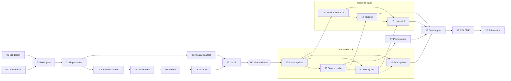

# Work Plan

This plan turns the exam specification into features, user stories and development tasks (exam section 9). It is
written for the reviewers and for whoever implements a task. For each task it states the required behavior, the
expected deliverable, its dependencies, an effort estimate and the exam requirements it covers.

How to build each part is technical guidance, kept in `CLAUDE.md` and `docs/code-patterns.md` and linked from every
task. Work that was left out on purpose is listed in [Out of scope](#out-of-scope).

## How to read this plan

- **Hierarchy:** Feature (`F<n>`) → user story (`US-<n>.<m>`) with acceptance criteria → task (two-digit ID). IDs are
  stable and mostly follow the execution order. Task 21 was added later and runs in phase 1; the
  [phases](#phases) and the [task board](#task-board) give the actual order.
- **What, not how:** A task states the required behavior and the deliverable that proves it. Its **Guidance** line
  points to the default approach in `CLAUDE.md` and `docs/code-patterns.md`. Defaults may change when that improves
  correctness, clarity or maintainability; the PR explains why. Mandatory constraints in `CLAUDE.md` don't change this
  way.
- **Branches and PRs:** Normally one branch and PR per task, named `feature/<id>-<short-name>` (for example
  `feature/10-status-concurrency`), in the repository the task changes (see [Repositories](#repositories) and the
  **Repo** column on the task board). Small, closely related tasks may share a branch and PR when together they form
  one coherent, reviewable change, for example 05 + 06 or 19 + 20. Documentation-only tasks (01, 02, 03, 19) are
  committed to `main` of the main repository directly, as `CLAUDE.md` allows.
- **Implementation plans:** Only tasks of 5 hours or more get a plan file in `docs/plan/<id>-<short-name>.md`: 04, 08,
  09, 10, 14 and 17. Other tasks are described in their PR.
- **Exam references:** `§1`–`§11` are the numbered sections of the exam. **Data** is the request-structure and test-data
  section; **Submission** is the submission section.
- **Roles** in user stories: *handler* (a person who works on requests), *team lead*, *reviewer* (the exam reviewer
  running the solution) and *developer*. The system has no authentication; roles only describe who needs the story.
- **Board:** `docs/board.html` shows this plan as a task board, with what's ready to start and a timeline. Run
  `node docs/board-server.mjs` from the main folder (on `main`, not a worktree) and open `http://localhost:4300/`. The
  board reads this file, so it never needs its own copy of the tasks, and a status or actual-hours change made on the
  board is written straight into the [task board](#task-board) table here. Commit those changes like any other edit.

## Repositories

The solution is split into three GitHub repositories. The main repository is the one reviewers clone; it includes the
other two as Git submodules:

| Repository | Contains | Path in the main repository |
|---|---|---|
| `request-tracker` (main) | `CLAUDE.md`, `README.md`, `docs/` (this plan, the board, performance and AI usage notes) | — |
| `request-tracker-server` | The .NET solution: API, Core, Infrastructure, tests, the SQL Server compose file | `backend/` |
| `request-tracker-client` | The Angular app | `frontend/` |

The main repository always points to the latest `main` of both submodules:

- `.gitmodules` sets `branch = main` for both submodules and uses HTTPS URLs, so an anonymous clone works.
- A workflow in each submodule repository runs on every push to its `main` and notifies the main repository. A
  workflow in the main repository then moves the submodule pointers to the latest `main` and commits the change. The
  same workflow also runs on a schedule, as a fallback if a notification fails, and can be started by hand.
- Submodule pointers change only through that workflow. Task PRs never change them by hand.
- Reviewers and developers clone with `git clone --recurse-submodules`. After a pull, `git submodule update --init`
  checks out the pointed commits.

Paths in `CLAUDE.md` and in this plan are relative to the main repository (for example `backend/src/RequestTracker.Api`).
Sessions always work from a checkout of the main repository, so they load `CLAUDE.md`. How to branch inside a submodule
is described in `CLAUDE.md` → Branches & commits.

## Features and user stories

The following table lists every feature, its user stories and the exam sections it serves:

| Feature | User stories | Exam | Tasks | Effort (h) |
|---|---|---|---|---|
| F0 Planning and design | US-0.1 Plan traced to the spec | §9, §10, §11 | 01, 02, 03 | 7 |
| F1 Foundation and test data | US-1.1 Runnable foundation · US-1.2 Realistic test data · US-1.3 Connected repositories | Data, §10, §11, Submission | 21, 04, 05, 06, 07 | 16 |
| F2 Find requests | US-2.1 Search, filter, sort and page | §1, §5 | 08, 09 | 16 |
| F3 Status update and concurrency | US-3.1 Change status safely | §2, §3, §5 | 10, 14 | 13 |
| F4 Change history | US-4.1 See change history | §3, §5 | 12, 15 | 6 |
| F5 Bulk status update | US-5.1 Update many requests at once | §4 | 11 | 4 |
| F6 Statistics and cache | US-6.1 See workload statistics | §1, §5, §7 | 13, 16 | 6 |
| F7 Performance | US-7.1 Performance evidence | §1, §6 | 17 | 6 |
| F8 Tests and code quality | US-8.1 Automated tests | §8, §10 | 18 (plus tests in every task) | 3 |
| F9 Documentation and submission | US-9.1 Understand and run the solution | §11, Submission | 19, 20 | 6 |
| **Total** | | | | **83** |

## Effort estimates

The estimates are planning figures based on these assumptions:

- One developer who knows .NET, Angular and SQL Server does the work, using AI assistance and reviewing all generated
  code manually.
- An estimate is focused hours for one task, including its tests, review fixes and its `AI_USAGE.md` entry. It
  excludes waiting time, such as waiting for a review.
- The **Actual** column on the [task board](#task-board) records real effort as tasks merge, so the estimates can be
  checked and the remaining ones corrected.

Total work effort and elapsed time are different measures:

| Measure | Hours | Meaning |
|---|---|---|
| Total work effort | 83 | Sum of all task estimates, 01–21. Planning (01–03, 7 h) is done or in review. |
| Total with contingency | ≈ 95 | Plus 15% for integration problems and review rework. |
| Remaining work | 76 | Tasks 04–21. |
| Elapsed time, one task at a time | ≈ 76 (≈ 87 with contingency) | Tasks 04–21 run in sequence, one session. |
| Elapsed time, parallel tracks | ≈ 57 | The critical path from the start of task 21, with up to three sessions at once (see [Critical path](#critical-path)). |

The 57 hours aren't the project duration. They exclude planning (01–03) and assume no waiting between tasks. Parallel
sessions shorten implementation, not review: the developer still reviews every PR. So the real elapsed time for tasks
04–21 falls between about 57 and 87 hours.

## Execution order and dependencies

### Phases

Work runs in five phases. Each phase starts when the tasks it depends on are merged:

| Phase | Tasks | How it runs |
|---|---|---|
| 0. Planning and design | 01, 02, 03 | Sequential, documentation only. |
| 1. Foundation | 21, then 04 → 05 → 06, and 07 in parallel | Task 21 creates the repositories first. Then sequential on the backend, because these tasks create the shared files (`Program.cs`, DB context, DI extensions, migrations). Task 07 is frontend-only, works in the client repository and sets no code patterns, so it runs in parallel. |
| 2. First vertical slice | 08 → 09, then milestone **M1** | One user story (US-2.1) in two sequential tasks, API then UI, so each PR stays reviewable. The seeder (06) runs first, so the slice is tested against 100,000 rows from the start. |
| 3. Features | Backend track 10 → 13 → 12 → 11; frontend track 14 → 16 → 15; task 17 | Two writer tracks and a performance task in parallel (see [Coordinating parallel work](#coordinating-parallel-work)). |
| 4. Hardening and delivery | 18 → 19 → 20 | Sequential, after all features and task 17. |

The milestones mark the points where the next phase can start:

- **M0 — Plan approved:** task 03 is accepted.
- **M1 — Slice reviewed:** tasks 08 and 09 passed `/code-review` and the developer's review, and their files are
  registered as reference implementations in `CLAUDE.md`. Phase 3 starts only after M1.
- **M2 — Feature complete:** tasks 10–17 are merged.
- **M3 — Ready to submit:** task 20 is done.

### Dependency graph

A solid arrow means "must be merged before" (a real dependency). A dotted arrow is track order only: the tasks don't
depend on each other but run one after the other because they share files.

### Critical path

The longest chain of dependent tasks, starting after planning, is:

21 (3) → 04 (5) → 05 (3) → 06 (3) → 08 (8) → 09 (8) → M1 → 10 (7) → 13 (4) → 12 (3) → 11 (4) → 18 (3) → 19 (4) →
20 (2) = **57 h**

The frontend track (10 → 14 → 16 → 15, also 18 hours after M1) is just as long, so both tracks are critical. Task 17
runs from the end of task 13 to about the same point, so it has almost no slack either. A delay in any of the three
delays task 18.

## Coordinating parallel work

Tasks 10–13 add methods to the same backend files (`RequestsController`, `RequestService`, `RequestRepository` and
their interfaces), and tasks 14–16 share `request.model.ts`, `requests-api.service.ts` and `requests.store.ts`. Even
additive changes to these files can conflict or rest on inconsistent assumptions. This section defines who owns which
files, the merge order, and how integration is checked after each merge.

### Ownership and merge order

After M1, each track owns a repository (or part of one) and runs its tasks one at a time, in a fixed order. Two
sessions never edit the same file at once:

| Track | Tasks, in merge order | Owns |
|---|---|---|
| Backend | 10 → 13 → 12 → 11 | `request-tracker-server`, and the API contract table in `CLAUDE.md` |
| Frontend | 14 → 16 → 15 | `request-tracker-client` |
| Performance | 17 | `docs/PERFORMANCE.md`; in the server repository, the entity configurations and a new migration, only if an index changes |
| Coordinating session | M1, documentation tasks | The main repository, except the API contract table |

The orders follow what other tasks wait for:

- **Backend:** 10 comes first because every other feature needs it. 13 comes next because tasks 16 and 17 wait for it.
  12 follows because task 15 needs it. 11 is last because no other task depends on it.
- **Frontend:** 14 needs only task 10. 16 comes before 15 because the statistics API (13) merges before the history API
  (12).
- **Performance:** in phase 3, only task 17 may change the schema. The backend track doesn't touch the entity
  configurations or migrations.

Every task appends its own entry to `docs/AI_USAGE.md`. The file only grows, so these merges don't conflict in a way
that matters.

### Shared assumptions

The tracks agree through the following rules, not through each other's branches:

- **The API contract is the interface.** The API contract table in `CLAUDE.md` is the shape the frontend codes
  against. A backend task that changes a request or response describes the change in its PR, and updates that table
  in the main repository when the PR merges.
- **Merged endpoints only.** A frontend task starts only after the endpoints it uses are merged (see the
  [dependency graph](#dependency-graph)).
- **Shared types change with notice.** `RequestDto`, `PagedResult` and the error codes change only together with a
  contract update and a note in the PR description.
- **Fixed business rules.** The [status transitions](#status-transitions) are defined before task 10 starts. A change
  is made in this plan first.

### Integration check after each merge

Before each merge, the branch syncs with the latest `main` of its repository and meets the
[definition of done](#definition-of-done). The main repository is where the two repositories meet, so the check runs
there. After the merge, wait for the update workflow to move the submodule pointer, then run the following check on
the main repository's `main`, before the next branch merges:

1. Pull with submodules, build the backend and the frontend, and run all tests.
2. After a frontend merge or an API contract change, run the UI against the API on the seeded database, and exercise
   the features merged so far: list, details, status update, history, statistics.
3. If anything fails, fix it in a `fix/` branch before anything else merges.

## Task board

The following table is the single place for task status, dependencies and estimates. "Depends on" lists real
dependencies; track order is in [Ownership and merge order](#ownership-and-merge-order). Update the table when a task
starts and when it is merged.

| ID | Task | US | Track | Repo | Depends on | Est. (h) | Status | Actual (h) |
|---|---|---|---|---|---|---|---|---|
| 01 | Requirements analysis and architecture conventions | US-0.1 | Planning | main | — | 3 | done | |
| 02 | Database selection and schema design | US-0.1 | Planning | main | — | 2 | done | |
| 03 | Work plan (this document) | US-0.1 | Planning | main | 01, 02 | 2 | in review | |
| 21 | Repositories, submodules and pointer updates | US-1.3 | Foundation | main, server, client | 03 | 3 | done | |
| 04 | Backend skeleton, cross-cutting concerns and local run setup | US-1.1 | Foundation | server | 21 | 5 | todo | |
| 05 | Data model, EF configuration and initial migration | US-1.1 | Foundation | server | 04 | 3 | todo | |
| 06 | Test data seeder (100,000 requests) | US-1.2 | Foundation | server | 05 | 3 | todo | |
| 07 | Angular app scaffold | US-1.1 | Foundation | client | 21 | 2 | todo | |
| 08 | List API: paging, filters, search, sort | US-2.1 | Slice | server | 05, 06 | 8 | todo | |
| 09 | List UI: search, filters, sort, paging | US-2.1 | Slice | client | 07, 08 | 8 | todo | |
| 10 | Status update with optimistic concurrency and audit | US-3.1 | Backend | server | M1 | 7 | todo | |
| 11 | Bulk status update (Partial Success) | US-5.1 | Backend | server | 10 | 4 | todo | |
| 12 | Status history API | US-4.1 | Backend | server | 10 | 3 | todo | |
| 13 | Statistics aggregations and cache | US-6.1 | Backend | server | 10 | 4 | todo | |
| 14 | Request details and status update UI | US-3.1 | Frontend | client | 10 | 6 | todo | |
| 15 | History UI | US-4.1 | Frontend | client | 12, 14 | 3 | todo | |
| 16 | Statistics UI | US-6.1 | Frontend | client | 13 | 2 | todo | |
| 17 | Performance analysis and index validation | US-7.1 | Performance | server, main | 13 | 6 | todo | |
| 18 | Test coverage and quality gate | US-8.1 | Delivery | server, client | 11, 15, 16, 17 | 3 | todo | |
| 19 | README and solution documentation | US-9.1 | Delivery | main | 17, 18 | 4 | todo | |
| 20 | Submission and clean-run verification | US-9.1 | Delivery | main | 19 | 2 | todo | |

Task 13 depends on task 10 because its cache test checks that a status update invalidates the statistics.

## Features, stories and tasks

### F0 Planning and design

**US-0.1 Plan traced to the spec.** As a reviewer, I want to see how the specification became architecture decisions
and a work plan, so that I can judge the planning and not only the product.

Acceptance criteria:

- Every exam requirement maps to at least one task (see [Traceability](#traceability)).
- Every task has a deliverable, dependencies and an estimate.
- Work other than coding (database design, tests, performance, documentation, run setup) has its own tasks.

#### 01 Requirements analysis and architecture conventions

Exam: §9, §10 · Status: done

- **Required:** Analyze the specification and the grading weights. Define the layering, naming, API contract, error
  contract, and the concurrency, audit and cache strategies, so that parallel sessions produce consistent code.
- **Deliverable:** `CLAUDE.md` and `docs/code-patterns.md`.

#### 02 Database selection and schema design

Exam: Data, §1, §6, §11 · Status: done

- **Required:** Choose the database (SQL Server, compared with PostgreSQL and MongoDB). Define the column types, the
  concurrency token, how a conditional update works, and the initial indexes with the query each one serves.
- **Deliverable:** `CLAUDE.md` → Database. The README reuses the reasoning (task 19) and task 17 validates the indexes.

#### 03 Work plan

Exam: §9 · Branch: none (documentation on `main`)

- **Required:** Break the specification into features, user stories and tasks, with dependencies, order, estimates,
  coordination rules and traceability.
- **Deliverable:** This document. It stays current: task status and actual effort are updated as tasks merge.

### F1 Foundation and test data

**US-1.1 Runnable foundation.** As a developer, I want a layered solution, a local database and shared error, JSON and
logging behavior, so that every feature follows one contract from the first commit.

Acceptance criteria:

- The solution builds, and project references enforce Api → Core ← Infrastructure.
- Errors are ProblemDetails with the status codes in `CLAUDE.md` → Error responses.
- SQL Server starts with one command, and the schema is applied automatically in Development.
- The Angular shell runs and reaches the API through a dev proxy.

**US-1.2 Realistic test data.** As a reviewer, I want to regenerate at least 100,000 deterministic test requests with one
command, so that I can test and measure the system at a realistic volume.

Acceptance criteria:

- One command creates at least 100,000 requests and can be run again at any time.
- Every run produces the same data.
- Inserts run in batches, and the seeding time is recorded.

**US-1.3 Connected repositories.** As a developer, I want the server and the client in their own repositories,
connected to the main repository, so that each side has its own history and PRs, while one clone of the main
repository gets the whole solution at its latest version.

Acceptance criteria:

- `request-tracker-server` and `request-tracker-client` exist as public repositories with a `main` branch.
- The main repository includes them as submodules at `backend/` and `frontend/`, tracking `main`, with HTTPS URLs.
- `git clone --recurse-submodules` of the main repository gets both submodules.
- After a push to `main` of either repository, the main repository points to that commit within a few minutes, with
  no manual step.

#### 21 Repositories, submodules and pointer updates

Exam: Submission · Branch: none (repository setup) · Runs first in phase 1

- **Required:**
  - Create `request-tracker-server` and `request-tracker-client` as public GitHub repositories, each with a `main`
    branch and a one-line README that points to the main repository.
  - Add them to the main repository as submodules at `backend/` and `frontend/`, tracking `main`, with HTTPS URLs.
  - Connect them as described in [Repositories](#repositories): a notifying workflow in each submodule repository, and
    a workflow in the main repository that moves both pointers to the latest `main`, also on a schedule and by hand.
    The token the notifying workflows need is created by the developer and stored as a repository secret, never
    committed.
- **Deliverable:** The acceptance criteria of US-1.3 hold. Nothing else: the solution, the app and the run
  instructions come in tasks 04, 07 and 19.
- **Guidance:** `CLAUDE.md` → Repository layout, Branches & commits.

#### 04 Backend skeleton, cross-cutting concerns and local run setup

Exam: §10, §11, Submission · Branch: `feature/04-backend-skeleton` · Plan file: yes

This is the run-setup task that `CLAUDE.md` refers to. The SQL Server compose file belongs to the server repository,
because the API is the only part that needs the database.

- **Required:**
  - The solution with the Api, Core and Infrastructure projects and the unit and integration test projects. Project
    references enforce the layering.
  - The shared behavior every feature relies on: camelCase JSON with enums as strings; one global error handler, so
    every error is ProblemDetails with the documented status code, and unexpected errors are logged with no internals
    in the response; one DI extension per project; the time provider and the hybrid cache; the cache key constants;
    an OpenAPI document and a Swagger UI page in Development, for manual calls.
  - The local run setup: SQL Server 2022 in Docker with one command, the dev connection string, `dotnet-ef` as a local
    tool, and a first "Run locally" section in the README.
- **Deliverable:** The build and tests pass, including a test of the exception-to-status mapping. `docker compose up -d`
  starts SQL Server. The API starts, serves the OpenAPI document and Swagger UI, and returns errors as ProblemDetails.
- **Guidance:** `CLAUDE.md` → Stack, Layer responsibilities, DI lifetimes, Error responses, Cache. Creates all shared
  backend files.

#### 05 Data model, EF configuration and initial migration

Exam: Data, §2, §3, §6 · Branch: `feature/05-data-model`

- **Required:** A request entity with the fields in the spec, and a status-history entity for the audit. Status and
  priority are stored as numbers, so priority sorts by meaning. Strings have explicit lengths, timestamps are UTC, and
  the database maintains the version. The initial set of indexes. The schema is applied automatically when the API
  starts in Development.
- **Deliverable:** An empty database gets the full schema when the API starts. The migration's indexes match
  `CLAUDE.md` → Indexes.
- **Guidance:** `CLAUDE.md` → Database. Only this task and task 17 change the schema.

#### 06 Test data seeder (100,000 requests)

Exam: Data, §6 · Branch: `feature/06-seeder` (may share a PR with 05)

- **Required:** One command that creates at least 100,000 requests. It produces the same data on every run, replaces
  existing test data, and inserts in batches. The data has realistic distributions:
  - a skewed status mix (most requests Completed), so that index selectivity in task 17 is realistic;
  - a few hundred organizations and tens of assignees;
  - `CreatedAt` spread over about two years, and `UpdatedAt` ≥ `CreatedAt`.

  History isn't seeded: it records changes made through the system.
- **Deliverable:** `dotnet run --project backend/src/RequestTracker.Api -- seed` creates the data in a measured time,
  noted for `docs/PERFORMANCE.md`. Two runs produce identical data.
- **Guidance:** `CLAUDE.md` → Seeding. Touches `Program.cs` (the `seed` command).

#### 07 Angular app scaffold

Exam: §5 · Branch: `feature/07-angular-scaffold` · Runs in parallel with 04–06

- **Required:** An Angular 22 app in `frontend/` with standalone components, strict TypeScript, Angular Material, the
  HTTP client and the router; a dev proxy to the API, so no CORS setup is needed; the `core/`, `features/` and
  `shared/` folders; an app shell.
- **Deliverable:** `npm start` serves the shell, `ng build` passes, and a proxied call reaches the API.
- **Guidance:** `CLAUDE.md` → Frontend conventions. Creates the frontend shared files.

### F2 Find requests

**US-2.1 Search, filter, sort and page.** As a handler, I want to search, filter, sort and page through requests, so
that I can find the ones I need among more than 100,000.

Acceptance criteria:

- Filters combine: status, priority, organization name (prefix match), assignee and a created-date range.
- Text search matches `Title` and `OrganizationName`.
- Results sort by `createdAt`, `updatedAt`, `priority` or `title`, ascending or descending, in a stable order across
  pages.
- Paging runs on the server. `pageSize` defaults to 20 and is at most 100. Invalid parameters return 400 with field
  errors.
- In the UI, typing in the search box is debounced. Filter, sort and page changes send the request immediately. A newer
  query cancels the one still pending.
- Any filter or sort change returns to page 1. The list shows loading, empty and error states.
- No filtering, sorting or paging happens in memory or on the client.

#### 08 List API: paging, filters, search, sort

Exam: §1, §8, §10 · Branch: `feature/08-list-api` · Plan file: yes · First vertical slice, backend

- **Required:**
  - `GET api/requests` as defined in the API contract: combined filters, text search, sorting in a stable order, and
    server-side paging with a limited page size.
  - Invalid parameters are rejected with field errors. The response contains DTOs only. Cancellation flows through
    every I/O call.
  - The integration test harness (the real API and a SQL Server container), used by every later integration test.
- **Deliverable:**
  - The endpoint, with every response code declared, so Swagger UI shows the real contract.
  - Unit tests for parameter validation.
  - Integration tests: combined filters with sort and paging return the right page and total count; invalid
    parameters return 400 with `errors`.
  - The generated SQL is checked: filtering, sorting, paging and counting run in the database.
  - The files are ready to be registered as reference implementations.
- **Guidance:** `CLAUDE.md` → API contract, Layer responsibilities, DTOs & mapping, Validation; `docs/code-patterns.md`
  → Controller, Repository.

#### 09 List UI: search, filters, sort, paging

Exam: §5 · Branch: `feature/09-list-ui` · Plan file: yes · First vertical slice, frontend

- **Required:**
  - The list view: a filter bar (status, priority, organization, assignee, date range, search), a sortable table and a
    paginator driven by the server's total count.
  - Search text is debounced. Filter, sort and page changes request immediately. A newer query cancels the pending one,
    and a failed request doesn't stop later searches.
  - Any filter or sort change returns to page 1. Loading, empty and error (with retry) states.
  - API access lives in an API service, state in the feature store, and display in components.
- **Deliverable:**
  - The list works against the seeded database.
  - The browser's network panel shows one request after typing stops, immediate requests for page and sort changes, and
    stale requests cancelled.
  - The files are ready to be registered as reference implementations.
- **Guidance:** `CLAUDE.md` → Frontend conventions (search pipeline); `docs/code-patterns.md` → Angular.

> **M1 — Slice reviewed.** Run `/code-review` on tasks 08 and 09, have the developer review them, then register their
> files in `CLAUDE.md` → Reference implementations. Phase 3 starts after this.

### F3 Status update and concurrency

**US-3.1 Change status safely.** As a handler, I want to change a request's status, so that the team sees its progress,
without overwriting a change that someone else made in the meantime.

Acceptance criteria:

- An unknown request returns 404, and an invalid status value returns 400. A transition that the
  [status transitions](#status-transitions) don't allow, including the current status, returns 422 with a clear
  message.
- The update is conditional on `version` in the database. A stale version returns 409. Of two overlapping updates with
  the same version, exactly one succeeds and the other returns 409.
- On success, `Status`, `UpdatedAt` and `Version` change together, and the response carries the new version.
- Every successful change writes exactly one audit row (`RequestId`, `PreviousStatus`, `NewStatus`, `ChangedAt`,
  `ChangedBy`) in the same transaction. A rejected update writes none.
- On 409, the UI tells the user that someone else changed the request and reloads it.

#### Status transitions

The exam requires rejecting transitions that aren't allowed but doesn't define them. The following matrix is the rule
for tasks 10, 11 and 14. It is decided before implementation, and a change to it is made here first. Rows are the
current status, columns the requested one:

| From \ To | New | InProgress | Waiting | Completed |
|---|---|---|---|---|
| **New** | No (same status) | Yes | No | No |
| **InProgress** | No | No (same status) | Yes | Yes |
| **Waiting** | No | Yes | No (same status) | Yes |
| **Completed** | No | Yes (reopen) | No | No (same status) |

The matrix follows these reasons:

- **Work starts before it waits or ends.** A New request goes to InProgress first, so someone picked up every request
  that waits or completes.
- **Waiting is a pause.** It returns to InProgress when work continues, or goes to Completed when the organization's
  answer resolves the request.
- **Nothing returns to New.** New means nobody has picked the request up yet. The history keeps the record of what
  happened.
- **Completed can be reopened.** Reopening to InProgress corrects a premature completion through a recorded transition.
- **The current status is rejected** with 422, or `InvalidTransition` in a bulk result. A successful no-op would either
  write an audit row for a change that didn't happen or return 200 without a new version. Rejecting it keeps the rule
  that every successful update changes `Version` and writes exactly one audit row.

#### 10 Status update with optimistic concurrency and audit

Exam: §2, §3, §7, §8 · Branch: `feature/10-status-concurrency` · Plan file: yes

- **Required:**
  - `GET api/requests/{id}`, for the details view and to return the new version after an update.
  - `PATCH api/requests/{id}/status` as defined in the API contract, with the outcomes in US-3.1: 400, 404, 422 from
    the transition matrix, 409 on a stale version enforced by the database, and 200 with the new version.
  - On success, `Status`, `UpdatedAt` and `Version` change together, and the audit row is written in the same
    transaction. The statistics cache is invalidated after the commit.
  - Conflicts are logged as Warning, without `changedBy`.
- **Deliverable:** The endpoints, with every response code declared, and these tests:
  - unit tests for every cell of the transition matrix, and for the service outcomes (404, 422, 409; cache invalidated
    only after a successful update);
  - integration test, stale version: update, then update again with the old version → 409, and no second audit row;
  - integration test, overlapping updates: two requests with the same version sent at the same time → exactly one 200,
    one 409, and exactly one audit row;
  - integration test, success: `Status`, `UpdatedAt` and `Version` change, and one audit row has every field.
- **Guidance:** `CLAUDE.md` → Concurrency & audit, Conditional update, Error responses; `docs/code-patterns.md` →
  Service, Repository, Tests.

#### 14 Request details and status update UI

Exam: §5 · Branch: `feature/14-details-status-ui` · Plan file: yes

- **Required:**
  - A details view, opened from the list, that shows every field and has loading, error and not-found states.
  - A status change. On 409, tell the user that someone else changed the request, and reload it. On 400 or 422, show
    the server's message. On success, keep the new version.
  - `changedBy` comes from an "acting as" name in the toolbar, because the system has no authentication.
  - The UI doesn't repeat the transition matrix (mandatory constraint 9). The server's 422 message explains a rejected
    transition.
- **Deliverable:** A manual check with two browser tabs: the second update shows the conflict message and the reloaded
  data.
- **Guidance:** `CLAUDE.md` → Frontend conventions.

### F4 Change history

**US-4.1 See change history.** As a handler, I want to see who changed a request's status and when, so that I
understand how it got to its current state.

Acceptance criteria:

- The history endpoint returns changes newest first, in pages, with the total count. An unknown request returns 404.
- The details view shows the history with loading, empty and error states, and refreshes it after the user's own
  update.
- When a request has more changes than are shown, the UI says so and can load the older ones. It never presents part
  of the history as the whole history.

#### 12 Status history API

Exam: §3 · Branch: `feature/12-history-api`

- **Required:** `GET api/requests/{id}/history`, newest first, paged with the same `page`/`pageSize` rules and result
  shape as the list. Paging keeps the response bounded and tells the client how many entries exist. An unknown request
  returns 404. An existing request with no changes returns an empty page.
- **Deliverable:** The endpoint, with every response code declared, the updated row in the API contract table, and integration tests:
  - after two updates, the history has two rows, newest first, with every audit field;
  - with more entries than the page size, `totalCount` is correct and the second page holds the older entries;
  - an unknown ID returns 404.
- **Guidance:** `CLAUDE.md` → API contract. Reuses the paging and validation from task 08.

#### 15 History UI

Exam: §3, §5 · Branch: `feature/15-history-ui`

- **Required:** The history in the details view, newest first, with loading, empty and error states. When the total
  count is larger than what is shown, the view says so and can load older entries. The history reloads after a
  successful status update.
- **Deliverable:** The history appears for a request changed through the UI, and a seeded request shows the empty
  state. With a small page size, the view shows that older entries exist and loads them.
- **Guidance:** `CLAUDE.md` → Frontend conventions.

### F5 Bulk status update

**US-5.1 Update many requests at once.** As a team lead, I want to change the status of up to 100 requests in one call
and get a clear result for each one, so that I can close or move work in batches.

Acceptance criteria:

- Each item contains at least an `id` and a `version`. Both are required and validated, and the IDs are distinct.
- A request with 1–100 valid items is accepted. A request that is invalid as a whole (no items, more than 100, a
  missing or malformed `id` or `version`, a duplicate ID) returns 400.
- **Partial Success:** each item is processed independently, with its own version check. The response lists
  `{ succeeded: [ids], failed: [{ id, reason }] }` with reasons `NotFound`, `Conflict` or `InvalidTransition`.
- Every succeeded item has exactly one audit row. The behavior and the reason for Partial Success are documented.

#### 11 Bulk status update (Partial Success)

Exam: §3, §4, §7 · Branch: `feature/11-bulk-status`

- **Required:**
  - `PATCH api/requests/status` with the validation and outcomes in US-5.1.
  - Each item gets the same version check, transition check and audit as a single update, in its own transaction.
    Per-item outcomes are returned as data, not exceptions.
  - The statistics cache is invalidated once if any item succeeded. One summary log line records the counts only.
- **Deliverable:** The endpoint, with every response code declared, and these tests:
  - unit tests: mixed outcomes fill `succeeded` and `failed` correctly; a missing or malformed `version`, a duplicate
    ID and 101 items each return 400;
  - integration test: a batch with one valid, one missing and one stale-version item returns 200 with the right
    per-item results, and only the valid item has an audit row.
- **Guidance:** `CLAUDE.md` → Concurrency & audit (Partial Success). Reuses task 10's conditional update for each item.
  There's no UI for this (see [Out of scope](#out-of-scope)).

### F6 Statistics and cache

**US-6.1 See workload statistics.** As a team lead, I want to see how many requests are in each status and priority, so
that I can follow the team's workload.

Acceptance criteria:

- At least two aggregations (count by status, count by priority) are computed in the database.
- The result is cached with a 5-minute expiration and invalidated by every successful status change, single or bulk.
- The UI shows the statistics with loading and error states.

#### 13 Statistics aggregations and cache

Exam: §1, §7 · Branch: `feature/13-stats-cache`

- **Required:** `GET api/requests/stats` with the total, the count by status and the count by priority, computed in the
  database. The result is cached for 5 minutes under the statistics tag that tasks 10 and 11 invalidate. The statistics
  are global, not per filter: that means one cache entry, which is cheap to invalidate. Filtered aggregations would
  need one entry per filter combination.
- **Deliverable:** The endpoint, with every response code declared, and these tests:
  - a unit test that a repeated call is served from the cache;
  - integration tests: the counts are correct for known test data, and they change right after a status update.
- **Guidance:** `CLAUDE.md` → Cache.

#### 16 Statistics UI

Exam: §5 · Branch: `feature/16-stats-ui`

- **Required:** The statistics (counts by status and by priority) shown with the list, with loading and error states,
  and loaded again when the user returns to the list.
- **Deliverable:** The numbers match the API and change after a status update.
- **Guidance:** `CLAUDE.md` → Frontend conventions.

### F7 Performance

**US-7.1 Performance evidence.** As a reviewer, I want measurements of the main operations on 100,000 rows, so that I can
see that the design works at that volume.

Acceptance criteria:

- At least two API operations are measured with an actual execution plan and at least one metric (logical reads, CPU,
  elapsed time).
- Every index has a stated reason, and a likely bottleneck has a proposed improvement.
- The documentation explains how the API avoids loading all data into memory.

#### 17 Performance analysis and index validation

Exam: §1, §6, §11 · Branch: `feature/17-performance` · Plan file: yes

- **Required:**
  - On the seeded database, measure these scenarios with actual execution plans and I/O and time statistics:
    - the list endpoint: default sort, status filter with sort, organization prefix, text search, sort by `title` and
      by `updatedAt`, and a deep page;
    - the statistics query, without the cache.
  - Check that each scenario uses the intended index, or explain why it doesn't. Change an index only when a
    measurement shows the need.
  - Identify the bottlenecks (expected: the `LIKE '%x%'` search scan, counting large filtered sets, deep offsets) and
    propose an improvement for each, for example Full-Text Search or keyset paging.
- **Deliverable:** `docs/PERFORMANCE.md` in the main repository, with the plan and metrics for each scenario, the index
  table with reasons, the generated SQL that shows filtering and paging run in the database, and each bottleneck with
  its improvement. A migration in the server repository, if an index changed.
- **Guidance:** `CLAUDE.md` → Indexes; `docs/code-patterns.md` → Repository.

### F8 Tests and code quality

**US-8.1 Automated tests.** As a reviewer, I want one command that runs meaningful automated tests, so that I can verify
the required scenarios myself.

Acceptance criteria:

- At least four meaningful tests, at least one of them an integration test through the API and a real database.
- Covered scenarios: a valid query or update, invalid input, a stale-version conflict and overlapping updates.
- `dotnet test` from the repository root runs every test, with Docker as the only prerequisite.

Most tests are written inside the feature tasks (08, 10, 11, 12, 13). Task 18 checks the whole.

#### 18 Test coverage and quality gate

Exam: §8, §10 · Branch: `feature/18-quality-gate`, in each repository that changes

- **Required:**
  - Map the existing tests to the §8 scenarios, and fill any gaps.
  - Run the full check from the main repository, with both submodules at their latest `main`.
  - Run `/code-review` on the whole solution.
  - Check the §10 items across the code: naming and duplication, DI lifetimes, async and cancellation, ProblemDetails on
    every error path, no sensitive data in logs, and no abstraction without a use.
- **Deliverable:** A green test run, with its summary in the README. Review findings are fixed or recorded as known
  limitations.

### F9 Documentation and submission

**US-9.1 Understand and run the solution.** As a reviewer, I want the repository alone to explain, run and justify the
solution, so that I can evaluate it without asking the author.

Acceptance criteria:

- The README covers every item of §11.
- A fresh clone runs by following the README literally.
- The repository is reachable through a link; nothing is sent as a ZIP file or an email attachment.

#### 19 README and solution documentation

Exam: §9, §11 · Branch: none (documentation on `main`)

- **Required:** A README with:
  - the purpose, the technologies and their versions;
  - prerequisites and run steps: clone with submodules, compose, seed, API, UI, tests;
  - the solution structure: the three repositories and the layers inside the server and client;
  - the database choice and indexes, with a link to `docs/PERFORMANCE.md`;
  - concurrency, the status transitions, and the bulk update with the reason for Partial Success;
  - the cache: what is cached and why, the expiration, the invalidation, and what changes with several server
    instances;
  - two significant technical decisions with the alternatives considered;
  - one known limitation and one possible improvement;
  - links to this plan and to `docs/AI_USAGE.md`, which this task consolidates.
- **Deliverable:** The README and a consolidated `docs/AI_USAGE.md`.

#### 20 Submission and clean-run verification

Exam: §11, Submission · Branch: `feature/20-submission`, only if fixes are needed (may share a PR with 19)

- **Required:**
  - Clone the main repository with `--recurse-submodules` into an empty folder, remove the Docker volumes, and follow
    the README literally: compose, seed, API, UI, tests.
  - Check that both submodule pointers are the latest `main` of their repositories, and that all three repositories
    are public. Submodule URLs must be HTTPS, so reviewers can clone without an SSH key.
  - Fix anything that is missing. Update the statuses and actual effort in this plan.
- **Deliverable:** A verified clean run, the final `main` of all three repositories, and the main repository's link for
  submission.

## Traceability

The following table maps each exam requirement to the tasks that implement it and to the place where a reviewer finds
the evidence:

| Exam | Requirement | Tasks | Evidence |
|---|---|---|---|
| Data | Request fields, including `RowVersion`/`Version` | 02, 05 | Entities, migration |
| Data | At least 100,000 records | 06 | `seed` command |
| Data | Database of the candidate's choice | 02 | README → Database |
| Data | Test data can be recreated | 06 | `seed` command (repeatable, deterministic) |
| §1 | Server-side pagination | 08 | `GET api/requests`, integration test |
| §1 | Combined filters: status, priority, organization, assignee, date range | 08, 09 | API, filter bar |
| §1 | Text search in `Title` and `OrganizationName` | 08, 09 | API, search box |
| §1 | Sort by at least three fields, ascending and descending | 08, 09 | `sortBy` (four fields), table headers |
| §1 | At least two aggregations | 13, 16 | `GET api/requests/stats`, statistics view |
| §1 | Page size limit and parameter validation | 08 | Validation, 400 integration test |
| §1 | `CancellationToken` in I/O operations | 04, 08 onward | Every repository and service method |
| §1 | DTOs, not DB entities | 08 onward | `Core/Mapping/`, DTO records |
| §1 | Document how full loads are avoided and how indexes support the main scenarios | 17, 19 | `docs/PERFORMANCE.md` |
| §2 | Unknown request returns a fitting status code | 04, 10 | 404 ProblemDetails |
| §2 | Invalid status or disallowed transition returns clear validation | 10 | 400; 422 from the [status transitions](#status-transitions) |
| §2 | Optimistic concurrency: one update succeeds, the other gets a conflict | 10 | Stale-version and overlapping-update integration tests |
| §2 | `UpdatedAt` and `Version` change consistently | 05, 10 | Database-maintained version, integration test |
| §2 | No lost updates | 10 | Conditional update in the database |
| §3 | Audit row for every status change | 05, 10, 11 | Same-transaction insert; exactly one row per success in tests |
| §3 | Endpoint for a request's history | 12, 15 | `GET api/requests/{id}/history` (paged), history view |
| §4 | Bulk update of up to 100 requests | 11 | `PATCH api/requests/status`, each item with `id` and `version` |
| §4 | Defined behavior for missing and conflicting items | 11, 19 | Per-item result, README |
| §4 | All-or-Nothing or Partial Success, with reasons and a clear response | 11, 19 | `CLAUDE.md` decision, README |
| §5 | Server-side search, filtering, sorting and paging | 09 | List view, network panel |
| §5 | Debounced search | 09 | Search text debounced; other controls immediate |
| §5 | Cancel or replace stale requests | 09 | A newer query cancels the pending one |
| §5 | Loading, empty and error states | 09, 14, 15, 16 | Every data view |
| §5 | Status update and 409 handling | 14 | Details view |
| §5 | Show aggregations | 16 | Statistics view |
| §5 | View change history | 15 | History in the details view |
| §5 | Components separated from services | 07, 09 | `core/api/`, stores, components |
| §6 | At least two API operations measured on 100,000 rows | 17 | `docs/PERFORMANCE.md` |
| §6 | Execution plan or an equivalent metric | 17 | Plans and I/O and time statistics |
| §6 | Indexes added and why | 02, 05, 17 | Index table in `docs/PERFORMANCE.md` |
| §6 | A likely bottleneck and an improvement | 17, 19 | `docs/PERFORMANCE.md`, README |
| §6 | No full load before filtering or paging | 08, 17 | Generated SQL |
| §7 | Cache for at least one aggregation | 13 | Statistics endpoint |
| §7 | Expiration | 13 | 5 minutes |
| §7 | Invalidation after updates | 10, 11, 13 | Tag invalidation, integration test |
| §7 | Reason for what is cached | 13, 19 | README → Cache |
| §7 | What changes with several server instances | 19 | README → Cache |
| §8 | At least four meaningful tests, one of them an integration test | 08, 10–13, 18 | `dotnet test` |
| §8 | Valid query, filter or update | 08, 10 | Integration tests |
| §8 | Validation of invalid input | 08, 10, 11 | Unit and integration tests |
| §8 | Concurrency conflict | 10 | Stale-version and overlapping-update integration tests |
| §8 | Integration test with the API and a database | 08 onward | Real API and SQL Server container |
| §9 | Work plan with tasks, order, dependencies and estimates | 03 | This document |
| §10 | Clear structure, naming, DTO mapping, DI lifetimes, async, global error handling, validation, safe logging, no over-engineering | 01, 04, every task, 18 | `CLAUDE.md`, [definition of done](#definition-of-done), review |
| §11 | Run instructions, technologies and versions, structure | 04, 19, 20 | README |
| §11 | Database choice and indexes | 02, 17, 19 | README, `docs/PERFORMANCE.md` |
| §11 | Concurrency and bulk update | 19 | README |
| §11 | Cache and invalidation | 19 | README |
| §11 | Two technical decisions with alternatives | 19 | README |
| §11 | One known limitation and one improvement | 17, 19 | README |
| §11 | AI usage: where, and what was checked or changed | every task, 19 | `docs/AI_USAGE.md` |
| Submission | Reviewers can access, run and inspect everything; no ZIP files | 21, 20 | Main repository link with submodules, clean-run check |

## Definition of done

A code task is done when all of the following are true:

1. The branch is in the repository the task changes, synced with that repository's latest `main`, and compared with
   the reference implementations and with similar code in `main`. Deviations from defaults are explained in the PR
   description. The PR doesn't change submodule pointers.
2. The solution builds, every test passes, and new behavior has tests named `MethodName_Scenario_ExpectedResult`.
3. `/code-review` passed and the developer reviewed the change.
4. The mandatory constraints in `CLAUDE.md` hold, in particular: no filtering, sorting or paging on the client; DTOs
   only; async with `CancellationToken`; ProblemDetails for errors; no sensitive data in logs.
5. API changes are reflected in `CLAUDE.md` → API contract, and every response code is declared, so the OpenAPI
   document and Swagger UI show the real contract.
6. The PR title starts with the task ID or IDs, and the description lists the shared files the task touched.
7. `docs/AI_USAGE.md` has an entry for the task, and the task's status and actual effort are updated in this plan.
8. After the merge and the submodule pointer update, the [integration check](#integration-check-after-each-merge) on
   the main repository passes.

## Out of scope

The following items are left out on purpose, to avoid over-engineering. Each one is a decision, not an omission:

| Item | Reason |
|---|---|
| Authentication and authorization | The spec doesn't ask for them. `changedBy` comes from the client's "acting as" name. Listed in the README as a known limitation. |
| Creating, editing or deleting requests | The spec covers finding, viewing, status updates and statistics. Data comes from the seeder. |
| Bulk update UI | §5 doesn't require it. The endpoint is covered by tests and can be called from Swagger UI. |
| Full-Text Search | Not included in the default SQL Server Docker image. It is the documented improvement for the search bottleneck. |
| Distributed cache and several server instances | §7 asks for a description. The solution runs as one instance; the README explains what changes for several. |
| Containers for the API and UI | Docker runs only SQL Server. The API and UI start with `dotnet run` and `npm start`, which keeps the run steps short. |
| Frontend unit tests | §8's scenarios are covered by backend unit and integration tests. |
| Live updates of other users' changes | Conflicts are handled with 409 and a reload. |
| CI that builds and tests every PR | Tests run locally with one command, and the integration check runs after each merge. The only workflows keep the submodule pointers current. |

## Risks

The following risks can affect the schedule:

| Risk | Mitigation |
|---|---|
| Integration tests need Docker and about 2 GB of RAM. | The README states the prerequisite, and the test harness is built early, in task 08. |
| Counting large filtered sets slows the list endpoint. | Measured in task 17, with an improvement proposed there. |
| Parallel tasks rely on shared files and assumptions. | Each track owns its files and merges in a fixed order, the API contract is the interface, and an integration check runs after each merge. |
| Both phase 3 tracks and task 17 are on the critical path. | A slip in any of them shows on the task board at once; task 17 can be narrowed to the two required operations first. |
| A reviewer clones without `--recurse-submodules` and gets empty `backend/` and `frontend/` folders. | The clone command is the first step in the README, and task 20 tests exactly that path. |
| The notification token expires or a notification fails, so the main repository falls behind. | The scheduled run of the update workflow catches up; task 20 checks the pointers before submission. |
| A session works in a submodule's detached `HEAD` and loses commits. | `CLAUDE.md` → Branches & commits: create the task branch inside the submodule from its latest `main` before any change. |
| Recent framework versions (.NET 10, Angular 22) have less documentation. | Versions are pinned in the README; problems are recorded in `docs/AI_USAGE.md` and the PR. |
